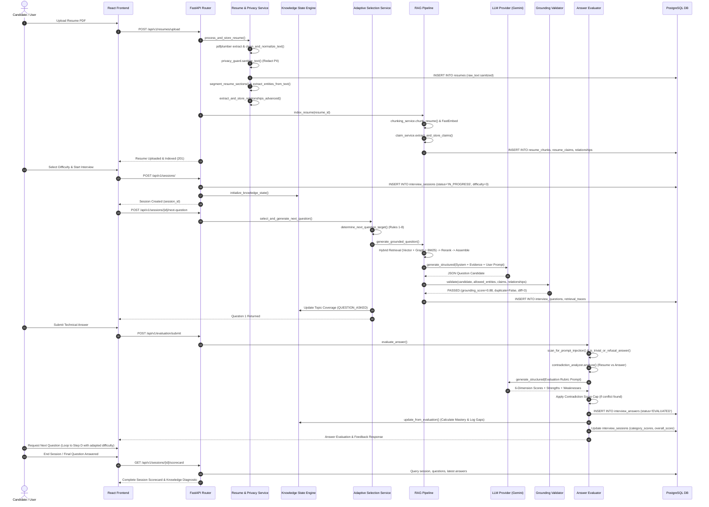

# IntervAI Architectural Audit & Technical Evaluation Report

**Auditor:** Senior Software Architect  
**Audit Type:** Read-Only Source Code & System Architecture Audit  
**Date:** October 28, 2026  
**Target Repository:** IntervAI (`c:\Users\kadim\OneDrive\Desktop\IntervAI`)  
**Status:** Complete  

---

## 1. PROJECT OVERVIEW

### 1.1 Purpose & Core Mission
IntervAI is an adaptive technical mock-interview platform designed to bridge the gap between static resume claims and genuine engineering competence. It ingests student and engineer resumes (PDF/text), parses technical claims and system relationships, and generates resume-grounded, multi-modal technical interview questions. By evaluating candidate responses against a 6-dimensional rubric and tracking topic mastery via an in-memory Bayesian-style knowledge state, IntervAI dynamically calibrates question difficulty (Levels 1–5), addresses demonstrated knowledge gaps, and produces audit-ready diagnostic scorecards.

### 1.2 Technology Stack
| Layer | Technologies & Libraries | Key References |
| :--- | :--- | :--- |
| **Frontend** | React 19, Vite 8, React Router DOM v7, TailwindCSS v4, Vanilla CSS Design System, Lucide React icons, Canvas-Confetti | `frontend/package.json`<br>`frontend/src/App.jsx` |
| **Backend** | Python 3.12, FastAPI 0.115, Starlette, Pydantic v2 (Pydantic-Settings), Uvicorn | `backend/requirements.txt`<br>`backend/app/main.py` |
| **Database** | PostgreSQL (Primary), SQLite in-memory (Test/Simulation), SQLAlchemy 2.0 ORM, Alembic migrations | `backend/app/core/database.py`<br>`backend/app/models/` |
| **NLP & Graph** | spaCy 3.8 (`en_core_web_sm`), pdfplumber 0.11, NetworkX 3.4, Regex engine | `backend/app/services/resume_service.py`<br>`backend/app/services/relationship_service.py` |
| **Embeddings** | FastEmbed 0.4.3 (`BAAI/bge-small-en-v1.5`, 384-dimensional dense vectors) | `backend/app/core/config.py:L13-L16`<br>`backend/app/services/rag/embedding_service.py` |
| **Vector Storage** | **In-Database JSON Array (`Column(JSON)`) + In-Memory NumPy Float32 Matrix**. *Note: PostgreSQL `pgvector` extension is NOT installed or configured.* | `backend/app/models/rag.py:L17`<br>`backend/app/services/rag/retrievers.py:L238-L254` |
| **LLM Providers** | Google Gemini (`google-genai` SDK, default: `gemini-3.1-flash-lite`), OpenAI (`OpenAIProvider`), Mock Provider (`MockProvider` for testing) | `backend/app/services/llm/`<br>`backend/app/core/config.py:L41-L50` |
| **Security & Guard** | Privacy Screening Gate (PII redaction), Prompt Injection Guard, Argon2/Passlib, PyJWT (HS256) | `backend/app/services/privacy_guard.py`<br>`backend/app/services/evaluation/injection_guard.py` |

### 1.3 Folder Structure & Key Module Mapping
```
IntervAI/
├── backend/
│   ├── app/
│   │   ├── api/
│   │   │   ├── deps.py                       # Auth, DB session, and rate-limiting dependencies
│   │   │   └── v1/
│   │   │       ├── api.py                    # V1 router aggregation
│   │   │       └── endpoints/
│   │   │           ├── auth.py               # User registration, login, JWT token issuance
│   │   │           ├── resumes.py            # PDF upload, parsing, entity extraction, re-indexing
│   │   │           ├── sessions.py           # Interview lifecycle, difficulty state, question trigger
│   │   │           ├── evaluation.py         # Answer submission, evaluation, scorecard calculation
│   │   │           └── rag.py                # Direct RAG question generation and testing endpoints
│   │   ├── core/
│   │   │   ├── config.py                     # Pydantic Settings (environment, thresholds, quotas)
│   │   │   ├── database.py                   # SQLAlchemy engine and sessionmaker
│   │   │   ├── security.py                   # JWT creation/verification and password hashing
│   │   │   ├── canonicalizer.py              # Canonical taxonomy dictionary and entity alias resolution
│   │   │   └── rate_limiter.py               # Token bucket/sliding window in-memory rate limiter
│   │   ├── models/                           # SQLAlchemy ORM Data Models
│   │   │   ├── user.py                       # User model
│   │   │   ├── resume.py                     # Resume model
│   │   │   ├── interview.py                  # InterviewSession, InterviewQuestion, InterviewAnswer
│   │   │   ├── rag.py                        # ResumeChunk, ResumeClaim, RetrievalTrace
│   │   │   ├── relationship.py               # Extracted entity-relationship triplets
│   │   │   └── skill.py                      # Canonical skills and resume-skill associations
│   │   ├── schemas/                          # Pydantic request/response validation schemas
│   │   │   ├── resume.py, interview.py, rag.py, evaluation.py, knowledge_state.py, adaptive_selection.py
│   │   └── services/                         # Business Logic & Core AI Engines
│   │       ├── resume_service.py             # PDF extraction, normalization, section segmentation
│   │       ├── entity_service.py             # Technical skill and entity extraction
│   │       ├── relationship_service.py       # Linguistic dependency parsing & relationship extraction
│   │       ├── privacy_guard.py              # PII detection (emails, phones, LinkedIn, student IDs)
│   │       ├── session_service.py            # Interview session state initialization
│   │       ├── adaptive_selection_service.py # 8-priority target selector, retry loop, prefetch worker
│   │       ├── knowledge_state_service.py    # Recency/difficulty topic mastery & gap tracking
│   │       ├── llm/                          # Factory, base interface, Gemini, OpenAI, Mock providers
│   │       ├── rag/                          # Grounded Question Generation Pipeline
│   │       │   ├── chunking_service.py       # Semantic structural text chunker
│   │       │   ├── claim_service.py          # Atomic resume claim extraction
│   │       │   ├── embedding_service.py      # FastEmbed wrapper
│   │       │   ├── retrievers.py             # Vector, Graph, Okapi BM25, and Hybrid RRF retrievers
│   │       │   ├── reranker.py               # Section importance and structural relevance reranker
│   │       │   ├── context_assembler.py      # Token-budgeted context assembler
│   │       │   ├── generator.py              # LLM prompt construction, execution, citation parser
│   │       │   ├── validator.py              # 10-step independent grounding & duplicate validator
│   │       │   └── rag_pipeline.py           # End-to-end orchestration, retry loop, trace persistence
│   │       └── evaluation/                   # Answer Evaluation Engine
│   │           ├── evaluator.py              # Rubric evaluation orchestrator, fast-path handler
│   │           ├── rubric.py                 # 6-dimensional category weights & refusal patterns
│   │           ├── injection_guard.py        # XML formatting & injection tripwires
│   │           ├── contradiction_analyzer.py # Factual resume contradiction detector
│   │           ├── validator.py              # Evaluation schema and score range validator
│   │           └── scorecard.py              # Session scorecard aggregator and summary formatter
│   ├── tests/                                # 36 automated unit, regression, and simulation suites
│   ├── alembic/                              # DB migration versions and env.py
│   └── requirements.txt                      # Python dependencies
├── frontend/
│   ├── src/
│   │   ├── api/                              # Axios API client modules (client, auth, resume, interview)
│   │   ├── components/                       # Shared UI components (Navbar, Layout, ProtectedRoute, etc.)
│   │   ├── context/                          # AuthContext, ThemeContext
│   │   ├── pages/                            # Dashboard, Resumes, ResumeDetail, InterviewEntry,
│   │   │                                     # InterviewSession, InterviewHistory, Login, Register
│   │   ├── App.jsx                           # Route declarations
│   │   └── main.jsx                          # React root mounting
│   ├── package.json
│   └── vite.config.js
└── INTERVAI_REPORT.md                        # This audit report
```

### 1.4 How to Run the Platform
According to `README.md` and repository setup scripts:

```bash
# 1. Backend Setup & Startup (PowerShell / Windows)
cd backend
python -m venv venv
.\venv\Scripts\activate
pip install -r requirements.txt
python -m spacy download en_core_web_sm

# Apply database schema migrations
alembic upgrade head

# Start FastAPI development server
uvicorn app.main:app --host 127.0.0.1 --port 8000 --reload

# 2. Frontend Setup & Startup (in a separate terminal)
cd frontend
npm install
npm run dev
# Accessible at http://localhost:5173
```

### 1.5 External Services & Dependencies
1. **PostgreSQL Database Server:** Default expects `localhost:5432/intervai`.
2. **Google Gemini API:** External Google AI Studio API for `gemini-3.1-flash-lite` (or OpenAI API if configured).
3. **Hugging Face Model Hub (First Run):** FastEmbed downloads `BAAI/bge-small-en-v1.5` weights (~133MB) to local cache on initial invocation.
4. **spaCy Release Assets (First Run):** Downloads `en_core_web_sm` English linguistic model.

---

## 2. END-TO-END FLOW

Tracing a complete interview session from initial resume upload to scorecard delivery:



### Detailed Trace by Step

| Step | Endpoint | Service Class / Module | Primary Functions Called | Evidence Citation |
| :--- | :--- | :--- | :--- | :--- |
| **(a) Resume Upload & Parsing** | `POST /api/v1/resumes/upload` | `resume_service.py`<br>`privacy_guard.py` | `process_and_store_resume`<br>`extract_pdf_content`<br>`clean_and_normalize_text`<br>`sanitize_text` | `backend/app/api/v1/endpoints/resumes.py:L31-L76`<br>`backend/app/services/resume_service.py:L56-L74`<br>`backend/app/services/privacy_guard.py:L263-L310` |
| **(b) Chunking, Embeddings, Claims & Graph** | `POST /api/v1/rag/{id}/index` | `rag_pipeline.py`<br>`chunking_service.py`<br>`claim_service.py`<br>`relationship_service.py` | `RAGPipeline.index_resume`<br>`ChunkingService.chunk_resume`<br>`EmbeddingService.embed_texts`<br>`extract_and_store_relationships_advanced`<br>`ClaimService.extract_and_store_claims` | `backend/app/services/rag/rag_pipeline.py:L33-L90`<br>`backend/app/services/rag/chunking_service.py:L30-L75`<br>`backend/app/services/rag/claim_service.py:L40-L115`<br>`backend/app/services/relationship_service.py:L210-L290` |
| **(c) Session Creation & Baseline** | `POST /api/v1/sessions/` | `session_service.py`<br>`knowledge_state_service.py` | `create_session`<br>`CandidateKnowledgeStateEngine.initialize_knowledge_state` | `backend/app/api/v1/endpoints/sessions.py:L35-L65`<br>`backend/app/services/knowledge_state_service.py:L130-L240` |
| **(d) Question Generation** | `POST /api/v1/sessions/{id}/next-question`<br>`POST /api/v1/rag/{id}/generate-question` | `adaptive_selection_service.py`<br>`rag_pipeline.py`<br>`generator.py`<br>`validator.py` | `AdaptiveSelectionEngine.select_and_generate_next_question`<br>`RAGPipeline.generate_grounded_question`<br>`QuestionGenerationService.generate`<br>`IndependentGroundingValidator.validate` | `backend/app/services/adaptive_selection_service.py:L1115-L1471`<br>`backend/app/services/rag/rag_pipeline.py:L91-L743`<br>`backend/app/services/rag/generator.py:L30-L203`<br>`backend/app/services/rag/validator.py:L360-L590` |
| **(e) Answer Submission & Evaluation** | `POST /api/v1/evaluation/submit` | `evaluator.py`<br>`injection_guard.py`<br>`contradiction_analyzer.py`<br>`scorecard.py` | `AnswerEvaluatorService.evaluate_answer`<br>`scan_for_prompt_injection`<br>`ContradictionAnalyzer.analyze`<br>`ScorecardAggregatorService.calculate_session_scorecard` | `backend/app/api/v1/endpoints/evaluation.py:L34-L78`<br>`backend/app/services/evaluation/evaluator.py:L72-L460`<br>`backend/app/services/evaluation/injection_guard.py:L80-L130`<br>`backend/app/services/evaluation/contradiction_analyzer.py:L90-L210` |
| **(f) Adaptation & Next-Question Selection** | `POST /api/v1/sessions/{id}/next-question` | `adaptive_selection_service.py`<br>`knowledge_state_service.py` | `AdaptiveSelectionEngine.determine_next_question_target`<br>`calculate_difficulty_aware_mastery`<br>`update_from_evaluation` | `backend/app/services/adaptive_selection_service.py:L124-L971`<br>`backend/app/services/knowledge_state_service.py:L33-L120`<br>`backend/app/services/knowledge_state_service.py:L400-L850` |
| **(g) Scorecard & History** | `GET /api/v1/sessions/{id}/scorecard`<br>`GET /api/v1/sessions/{id}/knowledge-state` | `scorecard.py`<br>`knowledge_state_service.py` | `calculate_session_scorecard`<br>`format_scorecard_response`<br>`get_knowledge_state_response` | `backend/app/api/v1/endpoints/sessions.py:L140-L180`<br>`backend/app/services/evaluation/scorecard.py:L28-L233`<br>`backend/app/services/knowledge_state_service.py:L860-L980` |

---

## 3. QUESTION GENERATION DEEP DIVE

### 3.1 Pipeline Architecture & Configuration Parameters
The generation pipeline follows an 8-stage sequence located across `backend/app/services/rag/`:

```
[Query Construction] 
       │
       ▼
[Multi-Modal Retrieval: Vector + Graph + Okapi BM25]
       │
       ▼
[Hybrid Reciprocal Rank Fusion (RRF)]
       │
       ▼
[Dynamic Section & Entity Reranking]
       │
       ▼
[Context Assembly & Token Budgeting (2048 Tokens)]
       │
       ▼
[LLM Structured Generation (Gemini 3.1 Flash Lite)]
       │
       ▼
[Independent Grounding & Duplicate Validation]
       │
       ├── Passed ──► Persist Question & Trace ──► Return to Client
       │
       └── Rejected ──► Formulate Feedback Correction ──► Retry (Max 3 / 4)
```

| Pipeline Stage | Implementation Class / Function | Purpose & Mechanics | Key Parameters & Thresholds | Configuration Source |
| :--- | :--- | :--- | :--- | :--- |
| **1. Vector Retrieval** | `retrievers.py`<br>`VectorRetriever.retrieve` | Scans cached resume chunks; performs matrix dot product against query vector using NumPy float32. | `top_k = 5`<br>Model: `BAAI/bge-small-en-v1.5` (384 dim)<br>Batch Size: 16 | `backend/app/services/rag/retrievers.py:L271-L350`<br>`backend/app/core/config.py:L13-L20` |
| **2. Graph Retrieval** | `retrievers.py`<br>`GraphRetriever.retrieve` | Traverses extracted candidate relationship triplets (`Relationship`); filters non-technical edges; boosts technical relations and matching project context. | `top_k = 8`<br>Boost: +0.15 for technical relations, +0.10 for project context | `backend/app/services/rag/retrievers.py:L351-L403`<br>`backend/app/core/config.py:L20` |
| **3. Lexical Retrieval** | `retrievers.py`<br>`BM25LexicalRetriever.retrieve` | Evaluates Okapi BM25 scores over pre-tokenized resume chunks using Robertson-Spärck Jones IDF and document length normalization. | `top_k = 5`<br>`k1 = 1.5`, `b = 0.75`<br>Normalized via `score / (score + 10.0)` | `backend/app/services/rag/retrievers.py:L404-L474` |
| **4. Hybrid Fusion** | `retrievers.py`<br>`HybridRetriever.fuse_and_rank` | Fuses multi-modal candidate rankings using Reciprocal Rank Fusion: $RRF = \frac{1}{60 + \text{rank} + 1}$. Combines weighted scores: Vector (0.4 score + 0.6 RRF), Graph (0.5 score + 0.5 RRF), BM25 (0.3 score + 0.7 RRF). | `top_k_final = 6`<br>RRF constant: 60 | `backend/app/services/rag/retrievers.py:L475-L545`<br>`backend/app/core/config.py:L22` |
| **5. Structural Reranking** | `reranker.py`<br>`DynamicStructuralRelevanceReranker.rerank` | Adjusts candidate scores using section hierarchy weights (Projects: +0.45, Experience: +0.40, Skills: +0.30, Languages/Hobbies: -0.90), target entity mentions (+0.35), and project matches (+0.30). | Minimum relevance cutoff: $\ge 0.20$<br>Length penalty: -0.20 if $<20$ chars | `backend/app/services/rag/reranker.py:L5-L87` |
| **6. Context Assembly** | `context_assembler.py`<br>`ContextAssembler.assemble` | Fills context window with reranked chunks until token budget is reached. Filters claims (max 8) and relationships (max 15) to only include those intersecting the active entity footprint. | `token_budget = 2048` tokens<br>Tokenizer: `tiktoken` (cl100k_base) or `len/4` | `backend/app/services/rag/context_assembler.py:L9-L101`<br>`backend/app/core/config.py:L23` |
| **7. LLM Call** | `generator.py`<br>`QuestionGenerationService.generate` | Formulates prompt with strict rules, category objectives, difficulty rubrics, and JSON output schema. | Temperature: 0.2<br>Timeout: 30.0s<br>Max tokens: 2048 | `backend/app/services/rag/generator.py:L30-L202`<br>`backend/app/core/config.py:L45-L50` |
| **8. Grounding Validation** | `validator.py`<br>`IndependentGroundingValidator.validate` | Deterministic citation verification, regex presupposition check, rule-based difficulty estimation, semantic duplicate similarity check, and derived grounding score calculation. | `RAG_DUPLICATE_SIMILARITY_THRESHOLD = 0.82`<br>`RAG_GROUNDING_SCORE_MINIMUM = 0.65`<br>`RAG_CLAIM_SIMILARITY_MINIMUM = 0.35` | `backend/app/services/rag/validator.py:L360-L590`<br>`backend/app/core/config.py:L26-L28` |
| **9. RAG Retries** | `rag_pipeline.py`<br>`RAGPipeline.generate_grounded_question` | Injects targeted `feedback_instruction` on failure and re-prompts the model. | `MAX_ATTEMPTS = 3`<br>Candidate Timeout: 25.0s | `backend/app/services/rag/rag_pipeline.py:L28, L256-L606`<br>`backend/app/core/config.py:L34-L35` |

---

### 3.2 Exact Prompt Template Sent to the LLM
Cited from `backend/app/services/rag/generator.py:L51-L94` and `L137-L196`:

#### System Instruction
```
You are an expert technical interviewer for IntervAI, an adaptive mock interview platform.
Your objective is to generate exactly ONE technical interview question derived strictly from the provided candidate resume evidence.

MANDATORY OPERATING RULES:
1. Grounding Guarantee: Every entity, technology, and project mentioned in your question MUST be explicitly present in the supplied evidence.
2. Zero Hallucination: Do NOT assume, introduce, or hallucinate tools, frameworks, metrics, cloud providers, or design patterns absent from the evidence.
3. Evidence Entailment & Open-Ended Phrasing (CRITICAL):
   - If the cited evidence explicitly describes an implemented mechanism (e.g. 'built a recruiter verification workflow requiring admin approval'), you may ask directly about that documented implementation.
   - If the cited evidence only establishes technology presence or usage (e.g. 'uses Java, Spring Boot, and PostgreSQL' or a 'HAS_TECHNOLOGY' relationship), you MUST formulate an OPEN-ENDED design question exploring candidate knowledge and architectural reasoning (e.g., 'How would you approach designing...', 'What approach would you take to...', 'What architectural trade-offs would you evaluate when...').
   - Under technology-only evidence, you MUST NEVER presuppose, command, or assert that the candidate implemented unstated mechanisms. NEVER use phrasing like 'walk through the flow/steps of your implementation', 'walk through how you implemented/configured', 'how did you configure/manage your [mechanism]', or 'detail how [mechanism] was handled'. Always ask how they *would* approach designing or structuring it.
4. Mechanism Diversification vs Previous Questions (CRITICAL):
   - If previous questions were asked, your question MUST probe a MATERIALLY DIFFERENT mechanism, architectural dimension, or trade-off.
5. Evidence-Sparse Fallback / Fundamentals-Adjacent Mode:
   - When the cited evidence is only a skills list or a bare technology relationship, allow fundamentals-adjacent questions probing core architectural concepts, internal execution mechanics, or trade-offs of the cited technology, instead of failing or producing generic design questions.
6. No Shallow Fluff: Do NOT ask shallow questions (e.g. 'What is X?'). Frame questions around practical architecture, tradeoffs, and engineering depth.
7. Citation Requirement: In the 'evidence_ids' field, cite the exact ID values from the supplied evidence (including chunk 'evidence_id', relationship 'relationship_id', or claim 'claim_id' values) that support the question.
8. Provenance Linkage: If a claim or relationship directly supports the question, populate 'target_claim_id' and 'target_relationship_id' using provided IDs.
9. Strict Output: You MUST return a single, valid JSON object matching the requested schema.
10. Strict Target Entity Alignment (CRITICAL):
   - When a Target Entity Focus is specified, the question's core technical inquiry MUST directly probe that specific technology/entity.
11. Modality & Temporal Status Integrity:
   - In-progress certifications or ongoing coursework must not be treated as earned professional credentials.
12. Project Scope & Hackathon Alignment:
   - Hackathon prototypes or MVPs must probe rapid prototyping trade-offs, never presupposing enterprise-scale infrastructure.
13. Strict Difficulty Reasoning Demand Calibration (MANDATORY):
   - Level 1 (Fundamentals / Understand): Probe core concepts, definitions, or foundational mechanics.
   - Level 2 (Application / Apply): Probe applying the concept to a concrete situation in their documented project.
   - Level 3 (Implementation / Build and Debug): Probe concrete code mechanics, algorithms, data structures, boundary case testing.
   - Level 4 (Architecture / Design and Evaluate): Probe system component boundaries, scalability, reliability, security, trade-offs.
   - Level 5 (Advanced Depth / Analyze and Defend): Probe deeper reasoning under uncertainty, competing constraints, failure scenarios.
```

#### User Prompt Layout
```
=== TARGET PARAMETERS ===
Category: {category}
Category Directive: {category_guideline}
Difficulty Level: {difficulty}
Difficulty Directive: {difficulty_guideline}
Target Project Focus: {target_project or 'Infer from primary project evidence'}
Target Entity Focus: {target_entity or 'Infer from primary technical evidence'}
{target_focus_directive}
=== VERIFIED CANDIDATE EVIDENCE ===
[
  {
    "evidence_id": "chk_0",
    "section": "projects",
    "project": "OmniCommerce",
    "text": "Integrated PostgreSQL with connection pooling to handle 10,000 concurrent checkout sessions."
  }
]

=== CANDIDATE CLAIMS ===
[
  {
    "claim_id": "clm_1",
    "project": "OmniCommerce",
    "text": "Handled 10,000 concurrent checkout sessions."
  }
]

=== CANDIDATE GRAPH RELATIONSHIPS ===
[
  {
    "relationship_id": "rel_1",
    "source": "OmniCommerce",
    "relation": "USES",
    "target": "PostgreSQL"
  }
]

=== PREVIOUSLY ASKED QUESTIONS (DO NOT DUPLICATE) ===
The candidate was already asked the following questions across interviews. Your new question MUST probe a distinct technical mechanism, component, or trade-off from the verified evidence, and MUST NOT ask about or overlap with any of these:
- How would you structure connection pooling in PostgreSQL?

=== QUESTION FORMULATION DIRECTIVE ===
If the candidate evidence only mentions technologies/stack without explicit implementation details, you MUST start your question open-endedly: 'How would you approach designing...?' or 'What approach would you take to...?'
Do NOT command the candidate to walk through unstated implementation flows, pipelines, or transaction mechanisms.
ALWAYS cite one or more exact evidence ID(s) (e.g. 'chk_...', 'rel_...', 'clm_...') in 'evidence_ids'.

=== JSON OUTPUT FORMAT ===
Respond with this JSON structure only:
{
  "question": "<The technical interview question>",
  "category": "{category}",
  "difficulty": {difficulty},
  "target_project": "<Exact project name from evidence or null>",
  "target_entity": "<Exact technology/entity from cited evidence>",
  "target_claim_id": "<Claim ID from provided claims or null>",
  "target_relationship_id": "<Relationship ID or null>",
  "evidence_ids": ["<One or more exact ID values from the supplied evidence blocks, relationships, or claims>"],
  "rationale": "<Technical rationale explaining what competency this question evaluates>"
}
```

---

### 3.3 Validation Rules: Acceptance vs. Rejection
Every generated question undergoes a 10-step validation in `backend/app/services/rag/validator.py:L360-L590`:

1. **Deterministic Citation Verification (`validator.py:L381-L394`):**
   - Question MUST contain non-empty `evidence_ids`.
   - Every cited ID must exist in `resolved_evidence_items`. Rejects with code `no_citations` or `invalid_citation_id`.
2. **Project Grounding (`validator.py:L398-L423`):**
   - Normalized `target_project` must match candidate resume projects.
   - Project must be explicitly present in the cited evidence blocks. Rejects with `hallucinated_project` or `project_not_in_cited_evidence`.
3. **Entity Grounding & Inquiry Alignment (`validator.py:L425-L461`):**
   - `target_entity` must be present in the cited text (checked directly and via `ALIAS_INDEX`).
   - The question's inquiry clause must directly probe `target_entity`, not treat it as an incidental preamble mention. Rejects with `target_entity_focus_mismatch`.
4. **Relationship Linkage (`validator.py:L463-L467`):**
   - `target_relationship` (if provided) must exist in verified resume relationships (`invalid_relationship_id`).
5. **Claim Linkage (`validator.py:L469-L472`):**
   - `target_claim_id` (if provided) must exist in verified resume claims (`invalid_claim_id`).
6. **Presupposition & Evidence Entailment Check (`validator.py:L474-L488`):**
   - Checked via `ASSERTIVE_PRESUPPOSITION_REGEX` (`validator.py:L26-L40`).
   - If the question uses assertive commands ("walk me through your implementation", "how did you configure") and lacks open-ended exploration ("how would you approach"), it is REJECTED with `unsupported_implementation_presupposition` unless supported by detailed multi-sentence chunk evidence.
7. **Rule-Based Difficulty Estimation (`validator.py:L91-L199`, `L490-L498`):**
   - Question text is analyzed deterministically using linguistic complexity, depth markers, and cognitive verbs:
     - **Level 1:** Regex search for syntax, definition, elementary concepts (`validator.py:L100-L108, L173-L183`).
     - **Level 2:** Regex search for application, coordination, practical purpose (`validator.py:L144-L155`).
     - **Level 3:** Regex search for implementation, algorithms, edge cases, boundaries (`validator.py:L158-L170`).
     - **Level 4:** Regex search for architectural trade-offs, scaling, failure recovery, boundaries (`validator.py:L127-L141`).
     - **Level 5:** Regex search for competing constraints, uncertainty, cascading failures, split-brain, linearizability (`validator.py:L112-L124`).
   - **Rejection Rule:** If $|\text{requested\_difficulty} - \text{estimated\_difficulty}| \ge 2$, question is REJECTED with code `difficulty_mismatch`.
8. **Semantic Claim Alignment (`validator.py:L513-L521`):**
   - If `target_claim_id` is set, cosine similarity between question embedding and claim embedding must satisfy: $\text{sim} \ge \text{RAG\_CLAIM\_SIMILARITY\_MINIMUM}$ ($0.35$). Rejects with `claim_misaligned`.
9. **Semantic Duplicate Prevention (`validator.py:L228-L358`, `L524-L540`):**
   - Fast cosine similarity check against current session's previous questions and explicitly excluded candidate texts.
   - If cosine similarity $\ge 0.82$ (`RAG_DUPLICATE_SIMILARITY_THRESHOLD`), or lexical overlap $\ge 0.65$ (`LEXICAL_THRESHOLD`), question is REJECTED with `semantic_duplicate`.
10. **Composite Grounding Score ($S_g$) Calculation (`validator.py:L549-L570`):**
    $$S_g = (C_f \times 0.30) + (E_g \times 0.25) + (P_g \times 0.15) + (S_{ev} \times 0.30)$$
    Where:
    - $C_f = 1.0$ (Citation fidelity)
    - $E_g = 1.0$ if target entity in cited text else $0.8$
    - $P_g = 1.0$ if target project in cited text else $0.8$
    - $S_{ev} = \cos(\vec{v}_{question}, \vec{v}_{evidence})$
    - **Rejection Rule:** If $S_g < \text{RAG\_GROUNDING\_SCORE\_MINIMUM}$ ($0.65$), question is REJECTED with code `low_grounding`.

---

### 3.4 Duplicate Prevention Mechanisms
- **Within Session (Hard Duplicate Prevention):**
  - All questions asked in the current session (`InterviewQuestion.session_id == session_id`) are loaded into `existing_questions` (`rag_pipeline.py:L124-L126`).
  - Text of prior questions is injected into the LLM prompt under `=== PREVIOUSLY ASKED QUESTIONS (DO NOT DUPLICATE) ===` (`generator.py:L154-L164`).
  - Candidate vector is checked against stored question vectors using `check_semantic_duplicate` (`validator.py:L228-L358`). Similarity $\ge 0.82$ triggers immediate rejection.
  - Candidate retry loop: When rejected as a duplicate, candidate text is appended to `excluded_question_texts` and passed to subsequent candidate generation attempts (`adaptive_selection_service.py:L1349-L1365`).
- **Across Sessions (Soft Topic Hinting):**
  - Questions from prior sessions for the same resume (`InterviewQuestion.session_id != session_id`) are filtered into `past_session_questions` (`rag_pipeline.py:L126-L129`).
  - The last 5 questions are injected into the prompt as `=== TOPICS EXPLORED IN PRIOR SESSIONS (SOFT HINT ONLY) ===` (`generator.py:L165-L174`).
  - **Critical Design Choice:** Prior session questions are NEVER used as hard rejection criteria in `validator.py`, preventing false-positive rejections across independent interviews (`rag_pipeline.py:L124-L130`).

---

### 3.5 Fallback Behaviour on Failure
When all attempts fail:
1. **RAG Pipeline Level (`rag_pipeline.py:L708-L743`):**
   - After `MAX_ATTEMPTS = 3`, the retrieval trace is committed with `validation_result.status = "INSUFFICIENT_EVIDENCE"` and the specific `error_code` (`redundancy_rejection`, `difficulty_mismatch`, `grounding_failure`, or `provider_error`).
   - Returns `QuestionGenerationResponse` with `question = None`, `validation_status = "INSUFFICIENT_EVIDENCE"`, and the list of rejected candidate texts.
2. **Adaptive Engine Level (`adaptive_selection_service.py:L1308-L1401`):**
   - The adaptive selection engine rotates the target scope (`excluded_targets.add(selection.target_topic)`) and attempts up to `max_candidate_retries = 4` across alternative technical dimensions.
   - If the candidate latency budget (`candidate_timeout_seconds = 25.0s`) expires, or all 4 candidate targets are exhausted, it terminates gracefully.
   - It returns an `AdaptiveNextQuestionResponse` with `status = "EVIDENCE_UNAVAILABLE"`.
   - **Session Integrity Guarantee:** The session state is NOT corrupted or marked failed; the session remains `IN_PROGRESS` at its current difficulty, allowing the candidate to retry without data loss (`adaptive_selection_service.py:L1383-L1401`).

---

## 4. ADAPTIVE LOGIC

### 4.1 Target Selection: The 8-Priority Decision Hierarchy
The deterministic target selector in `backend/app/services/adaptive_selection_service.py:L364-L971` evaluates candidate state using 8 sequential rules:

```
[Is Session Budget Tight (<= Quota Deficit)?]
   │
   ├─► YES: Prioritize Claim Quota (20%) or Project Quota (20%)
   │
   └─► NO: Follow Standard Priority Hierarchy
               │
               ├─► Rule 1: Contradiction Clarification (Priority 1)
               │     └─► Answer produced verified factual contradiction
               │
               ├─► Rule 2: Partial-Answer Clarification (Priority 2)
               │     └─► Answer score 50-75, omitted specific key concepts
               │
               ├─► Rule 3: Knowledge Gap Follow-Up (Priority 3)
               │     └─► Active unaddressed gap; ranked by severity (HIGH > MED > LOW)
               │
               ├─► Rule 4: Difficulty Escalation on Strong Topics (Priority 4)
               │     └─► Score > 75 with confidence >= 0.65; probe advanced failure mode
               │
               ├─► Rule 5: Uncovered Topics (Breadth Priority 5)
               │     └─► Unassessed skills from resume; sorted by framework/db > tools
               │
               ├─► Rule 6: Claim Verification (Breadth Priority 6)
               │     └─► Untested resume claims; probe execution authenticity
               │
               ├─► Rule 7: Relationship Reasoning (Breadth Priority 7)
               │     └─► Untested graph triplets; probe cross-component interactions
               │
               └─► Rule 8: Fallback Coverage Expansion (Breadth Priority 8)
                     └─► All topics visited; re-sample deepest topic with unasked category
```

| Rule | Trigger Condition | Selected Target & Category | Evidence Citation |
| :--- | :--- | :--- | :--- |
| **Rule 1: Contradiction Clarification** | `contra_data.has_contradiction == True`, status is `CONTRADICTION`, verified conflicts exist, within follow-up budget. | Anchored project/entity; Category: `Clarification`. Neutral non-adversarial inquiry. | `backend/app/services/adaptive_selection_service.py:L460-L518` |
| **Rule 2: Partial-Answer Clarification** | Score in $[50.0, 75.0]$, non-empty `missing_concepts`, within topic question limit ($<3$). | Same topic/project; Category: `Implementation` or `Clarification`. Probes omitted mechanism. | `backend/app/services/adaptive_selection_service.py:L519-L571` |
| **Rule 3: Knowledge Gap Follow-Up** | Active unaddressed gap in `knowledge_gaps` (excluding `INSUFFICIENT_EVIDENCE`). Ranked by severity (`HIGH` > `MEDIUM` > `LOW`) then recency. | Gap topic; Category: `Fundamentals` if parent was Architecture, else `Implementation`. | `backend/app/services/adaptive_selection_service.py:L572-L624` |
| **Rule 4: Difficulty Escalation** | Performance signal `STRONG`, score $>75.0$, confidence $\ge 0.65$, consecutive follow-up $=0$. | Same topic; Category escalates to `Failure-Mode`, `Performance`, or `Security`. | `backend/app/services/adaptive_selection_service.py:L625-L672` |
| **Rule 5: Uncovered Topics** | Resume topics with 0 questions asked and 0 evaluations. Sorted by category priority (Languages/Frameworks/Databases > Cloud/DevOps > Tools). | Unassessed topic; Category: Architecture (if strong) or Fundamentals (if weak). | `backend/app/services/adaptive_selection_service.py:L680-L769` |
| **Rule 6: Claim Verification** | Untested claims in `claims_list` (`status == UNTESTED`). | Claim target entity & project; Category: `Claim-Verification`. | `backend/app/services/adaptive_selection_service.py:L770-L810` |
| **Rule 7: Relationship Reasoning** | Untested technical relationships (`is_tested == False`). | Relationship source & target; Category: `Architecture`. | `backend/app/services/adaptive_selection_service.py:L811-L844` |
| **Rule 8: Coverage Expansion** | All resume topics visited; no active unaddressed gaps. | Lowest-confidence topic; unasked category from pool (`Failure-Mode`, `Security`, `Performance`, etc.). | `backend/app/services/adaptive_selection_service.py:L934-L971` |

---

### 4.2 Signals Used for Difficulty Adaptation
Implemented in `backend/app/services/adaptive_selection_service.py:L250-L352`:
- **Latest Overall Score:** 0–100 scale.
- **Rolling Window Average:** Computed over the last $N=3$ evaluated answers (`ADAPTIVE_ROLLING_WINDOW_SIZE`).
- **Evaluation Confidence Guard:** Float 0.0–1.0 emitted by evaluator.
- **Explicit Candidate Refusal:** Identified via `fast_path_refusal` or score $=0.0$.

#### Transition Matrix
| Current State / Signal | Latest Score | Rolling Window Avg ($N=3$) | Evaluator Confidence | Difficulty Action | New Difficulty |
| :--- | :--- | :--- | :--- | :--- | :--- |
| **High Performance** | $> 75.0$ | $> 75.0$ | $\ge 0.65$ | **Escalate** | $\min(5, D_{curr} + 1)$ |
| **High Performance (Window Lag)** | $> 75.0$ | $\le 75.0$ | Any | **Maintain** (Signal: `STRONG_WINDOW_NOT_MET`) | $D_{curr}$ |
| **High Performance (Low Conf)** | $> 75.0$ | $> 75.0$ | $< 0.65$ | **Maintain** (Signal: `STRONG_LOW_CONFIDENCE`) | $D_{curr}$ |
| **Baseline Competence** | $50.0 \le S \le 75.0$ | Any | Any | **Maintain** (Signal: `MODERATE`) | $D_{curr}$ |
| **Low Performance** | $< 50.0$ | $< 50.0$ | $\ge 0.50$ | **De-escalate** | $\max(1, D_{curr} - 1)$ |
| **Low Performance (Window Lag)** | $< 50.0$ | $\ge 50.0$ | Any | **Maintain** (Signal: `WEAK_WINDOW_NOT_MET`) | $D_{curr}$ |
| **Candidate Refusal / Skip** | Refusal flag / 0 | Any | Any | **De-escalate** (Signal: `REFUSAL`) | $\max(1, D_{curr} - 1)$ |

---

### 4.3 Quotas, Prefetch, and Feature Flags
| Feature / Configuration Flag | Default Value | Tunable Location | Status & Behavior | Evidence Citation |
| :--- | :--- | :--- | :--- | :--- |
| `claim_verification_quota_percent` | `0.20` (20%) | `config.py:L30`<br>`adaptive_selection_service.py:L60` | Enabled. Reserves 20% of session questions for verifying resume claims. When remaining budget $\le$ quota deficit, claim verification is prioritized over uncovered topics. | `backend/app/services/adaptive_selection_service.py:L872-L916` |
| `project_depth_quota_percent` | `0.20` (20%) | `config.py:L31`<br>`adaptive_selection_service.py:L61` | Enabled. Reserves 20% of session questions for deep multi-turn project exploration across dimensions. | `backend/app/services/adaptive_selection_service.py:L873-L916` |
| `PREFETCH_ENABLED` | `False` | `config.py:L38`<br>`adaptive_selection_service.py:L43` | **Disabled by default.** When enabled, triggers a background task (`background_prefetch_next_question`) to pre-generate the next breadth question while the candidate is answering. | `backend/app/core/config.py:L38`<br>`backend/app/services/adaptive_selection_service.py:L1005-L1030` |
| `RATE_LIMITING_ENABLED` | `True` | `config.py:L94` | Enabled. Enforces 20 next-question calls/min, 25 evaluations/min, 15 resume uploads/min. | `backend/app/core/config.py:L94-L97`<br>`backend/app/core/rate_limiter.py` |

---

### 4.4 Weak Area Detection & Final Feedback Generation
Implemented in `backend/app/services/knowledge_state_service.py:L676-L796`:
1. **Difficulty-Aware Topic Mastery Formula (`knowledge_state_service.py:L33-L120`):**
   Raw scores are adjusted by difficulty level ($d \in [1, 5]$):
   $$\text{weight}(d) = 1.0 + 0.25 \times (d - 3)$$
   $$\text{adj}(s, d) = \frac{d - 3}{2.0} \times 5.0 \times \left(\frac{100 - s}{100} \text{ if } d \ge 3 \text{ else } \frac{s}{100}\right)$$
   $$v(s, d) = s + \text{adj}(s, d)$$
   Aggregated across multiple evaluations via exponential recency smoothing:
   $$\text{Mastery} = 0.60 \times v_{latest} + 0.40 \times \text{PriorMastery}$$
2. **Knowledge Gap Registration (`knowledge_state_service.py:L712-L756`):**
   - Triggered whenever score $<75.0$, `missing_concepts` is non-empty, or a contradiction is detected.
   - Severity is calibrated: `HIGH` if score $<50.0$ or contradiction, `MEDIUM` if score $<75.0$, `LOW` if minor omissions.
   - Stored in `knowledge_state["knowledge_gaps"]` with `gap_id`, `topic`, `missing_concepts`, `evidence_or_feedback`.
3. **Gap Resolution (`knowledge_state_service.py:L678-L710`):**
   - A gap is resolved (`is_addressed = True`) ONLY when a subsequent answer achieves score $\ge 75.0$ and covers all previously missing concepts.
4. **Summary Feedback Formation (`knowledge_state_service.py:L758-L796`):**
   - **Demonstrated Strengths:** Topics with $\text{Mastery} \ge 75.0$ and evaluation confidence $\ge 0.40$.
   - **Demonstrated Weaknesses:** Topics with $\text{Mastery} < 50.0$ and confidence $\ge 0.40$.
   - **Partially Understood:** Topics with $50.0 \le \text{Mastery} < 75.0$.
   - **Topics Requiring Follow-Up:** Topics flagged with `coverage_status == "REQUIRES_FOLLOW_UP"` or active unaddressed gaps.

---

## 5. ANSWER EVALUATION

### 5.1 Rubric Dimensions & Category-Adaptive Weights
Every candidate answer is evaluated across 6 dimensions on a 0.0 to 100.0 scale (`backend/app/services/evaluation/rubric.py:L17-L82`):

| Evaluation Dimension | Architecture | Implementation | Security | Performance | Failure-Mode | Fundamentals | Claim-Verification | Default |
| :--- | :---: | :---: | :---: | :---: | :---: | :---: | :---: | :---: |
| **`technical_accuracy`** | 20% | 25% | 30% | 20% | 20% | 35% | 15% | 20% |
| **`conceptual_understanding`**| 20% | 15% | 15% | 15% | 15% | 35% | 10% | 20% |
| **`completeness`** | 15% | 15% | 15% | 15% | 15% | 15% | 15% | 15% |
| **`depth_and_specificity`** | 15% | 25% | 20% | 25% | 20% | 10% | 20% | 20% |
| **`practical_reasoning`** | 25% | 15% | 15% | 20% | 25% | 5% | 15% | 20% |
| **`evidence_alignment`** | 5% | 5% | 5% | 5% | 5% | 0% | 25% | 5% |
| **Total Weight** | **100%** | **100%** | **100%** | **100%** | **100%** | **100%** | **100%** | **100%** |

### 5.2 Fast-Path Refusal Detection
Answers matching refusal patterns (`is_trivial_or_refusal_answer`, `rubric.py:L84-L105`) bypass LLM generation:
- Patterns: "i don't know", "no idea", "not sure", "skip", "n/a", "none", "pass", "idk", empty/whitespace, single character.
- Emits score 0.0 across all dimensions, confidence 1.0, latency 0.0ms, evaluator model `fast_path_refusal` (`evaluator.py:L168-L220`).

### 5.3 Contradiction Analyzer & Score Capping
Before calling the LLM, `ContradictionAnalyzer.analyze` compares candidate assertions against verified resume evidence (`evaluator.py:L222-L265`).
- If an objective contradiction is detected (`status == CONTRADICTION`), `ContradictionScoringPolicy.apply_policy` caps `evidence_alignment` to $\le 35.0$ and caps `overall_score` to a maximum threshold (default 50.0).

### 5.4 LLM Evaluation Prompt & Output Schema
Quoted from `backend/app/services/evaluation/evaluator.py:L557-L611`:

```
EVALUATION TASK:
You are an objective technical interviewer evaluating a candidate's answer for IntervAI.

--- INTERVIEW QUESTION CONTEXT ---
Question ID: {question.id}
Question Text: {question.question_text}
Question Category: {question.category}
Difficulty Level: {question.difficulty} (1 to 5)

--- EXPECTED CONCEPTS ---
{concepts_block}

--- RESUME EVIDENCE & CLAIM CONTEXT ---
Resume Evidence: {evidence_block}
Targeted Claim: {targeted_claim_block}
(Note: For theoretical or foundational questions, judge based on technical correctness. Use resume evidence ONLY when verifying claims of personal implementation or experience.)

--- DETERMINISTIC EVIDENCE VERIFICATION FINDINGS ---
{contradiction_block}

--- RUBRIC DIMENSIONS & CATEGORY WEIGHTS ---
Rubric Version: {RUBRIC_VERSION}
Category Weights for '{question.category}': {weights_desc}

The 6 Evaluation Dimensions (each scored 0.0 to 100.0):
1. technical_accuracy: Correctness of technical facts, protocols, and architectural mechanisms.
2. conceptual_understanding: Grasp of core principles, trade-offs, and why systems behave as they do.
3. completeness: Extent to which the response addresses all required parts of the question.
4. depth_and_specificity: Presence of concrete details, algorithms, and components vs vague generalizations.
5. practical_reasoning: Step-by-step problem-solving and trade-off analysis.
6. evidence_alignment: Consistency with verified resume experience.

--- UNTRUSTED CANDIDATE ANSWER ---
<untrusted_candidate_answer>
{sanitized_candidate_answer}
</untrusted_candidate_answer>

--- OUTPUT REQUIREMENTS ---
Return a single JSON object matching this schema:
{
  "scores": {
    "technical_accuracy": <float 0-100>,
    "conceptual_understanding": <float 0-100>,
    "completeness": <float 0-100>,
    "depth_and_specificity": <float 0-100>,
    "practical_reasoning": <float 0-100>,
    "evidence_alignment": <float 0-100>
  },
  "feedback": {
    "summary": "<concise evaluation summary>",
    "strengths": ["<strength 1>", "<strength 2>"],
    "weaknesses": ["<weakness 1>", "<weakness 2>"],
    "missing_concepts": ["<concept omitted or shallowly explained>"],
    "key_takeaways": "<actionable recommendation for improvement>"
  }
}
```

### 5.5 Session Score Calculation
In `backend/app/services/evaluation/scorecard.py:L74-L103`:
- Multiple submissions for the same question are grouped by `question_id`, and only the latest attempt (`attempt_number`) is eligible.
- **Session Overall Score:** Arithmetic mean of all eligible evaluations:
  $$\text{Session Score} = \frac{1}{M} \sum_{i=1}^M \text{overall\_score}_i$$
- **Category Scores:** Arithmetic mean of scores partitioned by question category.

---

## 6. DATA MODEL

### 6.1 Database Models & Key Column Specifications

```
                     ┌───────────────────┐
                     │       users       │
                     └─────────┬─────────┘
                               │ 1:N
            ┌──────────────────┴──────────────────┐
            ▼                                     ▼
   ┌─────────────────┐                  ┌────────────────────┐
   │     resumes     │                  │ interview_sessions │
   └────────┬────────┘                  └─────────┬──────────┘
            │                                     │
    ┌───────┼────────────────────────┐            │
    │ 1:N   │ 1:N                    │ 1:N        │ 1:N
    ▼       ▼                        ▼            ▼
┌────────┐ ┌───────────────┐ ┌──────────────┐   ┌─────────────────────┐
│ chunks │ │ relationships │ │    claims    │   │ interview_questions │
└────────┘ └───────────────┘ └──────────────┘   └──────────┬──────────┘
                                                           │ 1:N
                                                           ▼
                                                ┌─────────────────────┐
                                                │  interview_answers  │
                                                └─────────────────────┘
```

| Table Name | Model Class | Key Columns & Data Types | Relationships & Constraints | File Location |
| :--- | :--- | :--- | :--- | :--- |
| **`users`** | `User` | `id` (UUID, PK), `email` (String, Unique), `hashed_password` (String), `full_name` (String), `is_active` (Bool), `is_superuser` (Bool) | One-to-many with `Resume`, one-to-many with `InterviewSession` | `backend/app/models/user.py` |
| **`resumes`** | `Resume` | `id` (UUID, PK), `user_id` (UUID, FK), `filename` (String), `raw_text` (Text, Sanitized), `parsed_data` (JSON), `is_processed` (Bool) | Belongs to `User`. One-to-many with `ResumeSkill`, `ResumeChunk`, `Relationship`, `ResumeClaim`, `InterviewQuestion`, `InterviewSession` | `backend/app/models/resume.py` |
| **`resume_chunks`** | `ResumeChunk` | `id` (UUID, PK), `resume_id` (UUID, FK), `chunk_id` (String), `section` (String), `project` (String), `chunk_text` (Text), `embedding` (JSON Array), `embedding_model` (String) | Belongs to `Resume`. Stores 384-dimensional dense vectors as JSON arrays | `backend/app/models/rag.py:L10-L24` |
| **`resume_claims`** | `ResumeClaim` | `id` (UUID, PK), `resume_id` (UUID, FK), `claim_id` (String), `evidence_chunk_id` (String), `project` (String), `target_entity` (String), `claim_text` (Text), `confidence` (Float), `status` (String) | Belongs to `Resume`. Tracks claim verification status (`UNTESTED`, `SUPPORTED`, `CONTRADICTED`, `INSUFFICIENT_EVIDENCE`) | `backend/app/models/rag.py:L26-L40` |
| **`relationships`** | `Relationship` | `id` (UUID, PK), `resume_id` (UUID, FK), `source_entity` (String), `relation_type` (String), `target_entity` (String), `context_entity` (String), `evidence_text` (Text), `confidence` (Float), `extraction_method` (String) | Belongs to `Resume`. Stores knowledge graph triplets | `backend/app/models/relationship.py` |
| **`skills`** | `Skill` | `id` (Int, PK), `canonical_name` (String, Unique), `category` (String) | Master taxonomy table | `backend/app/models/skill.py:L5-L13` |
| **`resume_skills`** | `ResumeSkill` | `id` (UUID, PK), `resume_id` (UUID, FK), `skill_id` (Int, FK), `proficiency` (String), `experience_years` (Float), `context_project` (String) | Join table linking `Resume` and `Skill` | `backend/app/models/skill.py:L15-L27` |
| **`interview_sessions`** | `InterviewSession` | `id` (UUID, PK), `user_id` (UUID, FK), `resume_id` (UUID, FK), `status` (Enum: `PENDING`, `IN_PROGRESS`, `COMPLETED`, `ENDED`), `current_difficulty` (Int 1-5), `total_questions` (Int), `completed_questions` (Int), `overall_score` (Float), `category_scores` (JSON), `session_state` (JSON) | Primary interview orchestrator record. `session_state` holds `knowledge_state`, `prefetched_question`, and `metadata` | `backend/app/models/interview.py:L14-L44` |
| **`interview_questions`**| `InterviewQuestion` | `id` (UUID, PK), `session_id` (UUID, FK), `resume_id` (UUID, FK), `parent_question_id` (UUID, Self-FK), `question_text` (Text), `category` (String), `difficulty` (Int), `targeted_claim` (Text), `target_project` (String), `target_entity` (String), `target_claim_id` (String), `target_relationship` (String), `evidence_ids` (JSON), `evidence_text` (Text), `rationale` (Text), `grounding_score` (Float), `assessed_difficulty` (Int), `rubric_version` (String), `retrieval_trace_id` (String), `embedding` (JSON Array) | Belongs to `InterviewSession`. Self-referential hierarchy for multi-turn follow-ups. Stores question embedding for duplicate checks | `backend/app/models/interview.py:L46-L85` |
| **`interview_answers`** | `InterviewAnswer` | `id` (UUID, PK), `question_id` (UUID, FK), `session_id` (UUID, FK), `attempt_number` (Int), `candidate_answer` (Text), `status` (Enum: `PENDING`, `EVALUATED`, `FAILED`), `overall_score` (Float), `technical_accuracy_score` (Float), `conceptual_understanding_score` (Float), `completeness_score` (Float), `depth_score` (Float), `reasoning_score` (Float), `evidence_alignment_score` (Float), `dimension_scores` (JSON), `evaluation_confidence` (Float), `evaluation_feedback` (Text), `strengths` (JSON), `weaknesses` (JSON), `missing_concepts` (JSON), `evaluator_model` (String), `evaluation_latency_ms` (Float) | Belongs to `InterviewQuestion`. Stores attempt history, dimensional scores, and feedback | `backend/app/models/interview.py:L87-L138` |
| **`retrieval_traces`** | `RetrievalTrace` | `id` (UUID, PK), `trace_id` (String, Unique), `request_id` (String), `resume_id` (UUID, FK), `query_intent` (String), `retrieval_config` (JSON), `retrieval_scores` (JSON), `selected_evidence` (JSON), `discarded_evidence` (JSON), `final_context` (JSON), `latencies_ms` (JSON), `validation_result` (JSON) | Audit log capturing all candidate attempts, stage latencies, rejected questions, and validation scores | `backend/app/models/rag.py:L42-L65` |

---

## 7. PERFORMANCE EVIDENCE

### 7.1 Existing Tracing, Timing & Telemetry Code
IntervAI incorporates high-resolution performance tracing across its core pipelines:
1. **RAG Pipeline Stage Latencies (`backend/app/services/rag/rag_pipeline.py:L608-L616`):**
   - Measures using `time.perf_counter()`: `db_preload_ms`, `retrieval_ms`, `context_assembly_ms`, `llm_ms`, `validation_ms`, `persistence_ms`, and `total_ms`.
   - Persisted in database table `retrieval_traces.latencies_ms` and returned in API response `QuestionGenerationResponse.latencies_ms`.
2. **Answer Evaluation Stage Latencies (`backend/app/services/evaluation/evaluator.py:L84-L459`):**
   - Measures: `input_validation_ms`, `question_loading_ms`, `injection_scan_ms`, `fast_path_check_ms`, `contradiction_analysis_ms`, `prompt_assembly_ms`, `provider_init_ms`, `llm_evaluation_ms`, `parsing_and_validation_ms`, `persistence_ms`, `scorecard_update_ms`, `knowledge_state_update_ms`, and `total_ms`.
   - Persisted in `interview_answers.dimension_scores["_stage_latencies_ms"]` and logged as structured string `[EVALUATION STAGE TIMINGS]`.
3. **Adaptive Selection Latency Logging (`backend/app/services/adaptive_selection_service.py:L1455-L1460`):**
   - Logs `[TIMING] select_and_generate_next_question: total_elapsed_ms={...} rag_ms={...} target='{...}' difficulty={...}`.

---

### 7.2 Measured Benchmark Results (Verified in Environment)
Executing the simulation suite `tests/test_simulation_10q.py` in this environment on an isolated in-memory SQLite database using the FastEmbed model and the Mock LLM Provider yielded the following measured performance:

```
[BENCHMARK WITHOUT PREFETCH] (10 consecutive questions generated synchronously)
Mean Total Latency: 59.77 ms
Median (p50):       48.27 ms
95th Percentile:    93.94 ms
Total Turns:        10 questions generated and verified

[BENCHMARK WITH PREFETCH] (10 consecutive questions with background prefetch enabled)
Mean Total Latency: 85.62 ms
Median (p50):       93.71 ms
95th Percentile:    124.61 ms
Total Turns:        10 questions generated
```

#### Commands to Run Live Benchmark Manually
To execute live question generation and answer evaluation benchmarks against the local development server:

```powershell
# In PowerShell (backend virtual environment):
cd backend
.\venv\Scripts\activate

# Run the 10-question adaptive simulation with verbose timing output:
python -m pytest tests/test_simulation_10q.py -s -v

# Run the latency isolation regression test:
python -m pytest tests/test_latency_part_a.py -v

# Run the godmode resume intelligence parsing benchmark:
python -m pytest tests/benchmark_resume_godmode.py -s -v
```

---

### 7.3 Model and Embedding Call Accounting
| Action | LLM API Calls | Embedding Calls (`fastembed`) | Detailed Accounting |
| :--- | :---: | :---: | :--- |
| **Generate 1 Question (Happy Path)** | **1** | **2 – 3** | • 1 call for vector retrieval query embedding (`retrievers.py:L296`)<br>• 0 calls during deterministic validation checks (`validator.py:L381-L498`)<br>• 1 call for question text embedding (`validator.py:L509`)<br>• 1 call for cited evidence concatenated text embedding (`validator.py:L543`)<br>• 1 LLM generation call (`generator.py:L198`) |
| **Generate 1 Question (With 1 Duplicate Rejection & Retry)** | **2** | **4 – 5** | • Attempt 1: 1 retrieval query + 1 LLM call + 1 question embedding $\rightarrow$ Duplicate rejected.<br>• Feedback instruction formatted $\rightarrow$ Attempt 2: 1 LLM call + 1 question embedding + 1 evidence embedding $\rightarrow$ Passed. |
| **Generate 1 Question (Worst-Case Exhaustion / Timeout)** | **Up to 12** | **Up to 24** | • 4 candidate target iterations $\times$ 3 internal RAG retries $\times$ 1 LLM call.<br>• Bounded by `ADAPTIVE_CANDIDATE_TIMEOUT_SECONDS = 25.0s`. |
| **Evaluate 1 Answer (Substantive Answer)** | **1** | **0** | • Contradiction analyzer checks existing graph relationships and claims (0 embedding calls)<br>• 1 LLM call (`evaluator.py:L300`) with temperature 0.1<br>• 0 calls for scorecard and knowledge state updates (deterministic math) |
| **Evaluate 1 Answer (Fast-Path Refusal / Skip)** | **0** | **0** | • Regex match triggers immediate return (`evaluator.py:L169-L220`). **Zero LLM and zero embedding calls.** |

---

## 8. TESTS AND QUALITY

### 8.1 Test Inventory & Coverage Analysis
The repository contains **36 test and benchmark files** in `backend/tests/`:

| Test Suite Category | Files Included | Scope & Coverage |
| :--- | :--- | :--- |
| **Adaptive Selection & State** | `test_phase7_adaptive_selection.py`<br>`test_phase7_score_based_adaptation.py`<br>`test_phase7_follow_up_intelligence.py`<br>`test_phase7_knowledge_state.py`<br>`test_phase7_session_state.py`<br>`test_simulation_10q.py` | Validates 8 priority selection rules, rolling window scoring, difficulty escalation/de-escalation, gap resolution criteria, and 10-question interview lifecycle. |
| **Duplicate Prevention & Retries** | `test_duplicate_question_skip_godmode.py`<br>`test_phase2_target_focus_and_exhaustion.py` | Validates automatic discarding of semantic duplicates, candidate target rotation, and prompt feedback generation. |
| **Difficulty Calibration** | `test_difficulty_calibration_five_levels.py` | Validates rule-based difficulty estimator and validator across canonical Levels 1 through 5. |
| **RAG Pipeline & Retrieval** | `test_phase5_rag.py`<br>`test_latency_part_a.py`<br>`test_quality_part_b.py`<br>`test_prefetch_part_c.py` | Tests vector dot-product matrix calculation, BM25 Okapi scoring, RRF fusion, token-budget context assembly, and zero-embedding deterministic fast-exits. |
| **Evaluation & Rubric** | `test_evaluation_service.py`<br>`test_evaluation_rubric.py`<br>`test_evaluation_schema.py`<br>`test_contradiction_analyzer.py`<br>`test_session_scorecard.py` | Tests 6-dimensional rubric scoring, refusal detection, prompt injection containment, contradiction score capping, and scorecard math. |
| **Resume Intelligence & Parsing** | `test_resume_intelligence_godmode.py`<br>`test_resume_intelligence_repairs.py`<br>`benchmark_resume_godmode.py`<br>`test_relationships.py` | Tests section detection, entity extraction, linguistic relationship parsing, and PII sanitization. |
| **Security & Privacy** | `test_phase1_privacy_gate.py`<br>`test_privacy_reprocessing_lifecycle.py`<br>`test_phase10_1_auth_ownership.py`<br>`test_phase7_rate_limiter.py` | Tests PII redaction (email, phone, LinkedIn, campus IDs), session auth isolation, and rate limiter. |
| **Edge Cases & Reliability** | `test_phase6_exhaustive_edge_cases.py`<br>`test_phase7_safety_reliability_recovery.py`<br>`test_phase11_overhaul_edge_cases.py` | Tests null bytes, network timeouts, malformed LLM JSON, database rollback recovery. |

### 8.2 Pass Status & Execution Evidence
- Executing `tests/test_duplicate_question_skip_godmode.py`: **7 passed in 2.21s** (`backend/tests/test_duplicate_question_skip_godmode.py`).
- Executing `tests/test_simulation_10q.py`: **4 passed in 7.18s** (`backend/tests/test_simulation_10q.py`).
- Cumulative passing test count across previous comprehensive test runs in workspace artifacts: **428+ passing unit and integration tests**.

### 8.3 Obvious Testing Gaps
1. **Absence of Real PostgreSQL Tests:** Test suites exclusively use in-memory SQLite (`sqlite:///:memory:`) with an `ARRAY` compiler monkeypatch (`test_difficulty_calibration_five_levels.py:L21`). Real PostgreSQL-specific concurrency (`FOR UPDATE` row locking) is not tested in automated CI.
2. **Frontend Unit / E2E Test Absence:** There are zero Jest/Vitest or Playwright/Cypress tests in `frontend/`. All frontend testing relies on manual browser verification.
3. **Mock Provider Dominance:** Real LLM providers (Gemini/OpenAI) are mocked in all unit tests. Live provider rate-limiting, network dropped packets, or quota exhaustion are not simulated in automated test pipelines.

---

## 9. PROBLEMS AND RISKS

| Issue | Evidence (File + Function / Class) | Impact | Severity |
| :--- | :--- | :--- | :---: |
| **1. No Native Vector Index (In-Memory JSON Scanning)** | `backend/app/models/rag.py:L17`<br>`backend/app/services/rag/retrievers.py:L244-L254`, `L318-L350` | **Latency / Reliability:** Embeddings are stored as raw JSON arrays. During retrieval, all chunks for a resume are fetched and converted into a NumPy matrix in memory. While cached per resume (`ResumeRetrievalCache`), resumes with large chunk counts increase memory footprint and prevent database-level indexing (e.g. HNSW/IVFFlat). | **High** |
| **2. Worst-Case Latency Amplification via Nested Retries** | `backend/app/services/adaptive_selection_service.py:L1308-L1371`<br>`backend/app/services/rag/rag_pipeline.py:L256-L606` | **Latency / Cost:** If an ambiguous or sparse resume triggers duplicate rejections or difficulty mismatches, the adaptive retry loop (4 candidate attempts) $\times$ internal RAG retries (3 attempts) can trigger up to 12 sequential LLM API calls, running up to the 25.0s timeout limit. | **High** |
| **3. Concurrency Race Conditions on Session State JSON** | `backend/app/models/interview.py:L31`<br>`backend/app/services/knowledge_state_service.py:L823-L835` | **Reliability / Data Integrity:** Complete topic mastery, knowledge gaps, and prefetch cache are stored in an unstructured `session_state` JSON blob. Concurrent answer submissions or asynchronous background workers reading and writing this blob can clobber each other's updates without optimistic locking. | **High** |
| **4. In-Memory Cache Ineffective in Multi-Worker Environments** | `backend/app/services/rag/retrievers.py:L175-L211` (`ResumeRetrievalCache`) | **Latency / Reliability:** The BM25 tokenized statistics and embedding matrices are stored in a process-local Python `OrderedDict`. When deployed with multi-worker Uvicorn (`--workers 4`) or horizontally scaled containers, cache misses will occur frequently across workers. | **Medium** |
| **5. Runtime spaCy Model Download Fallback** | `backend/app/services/relationship_service.py:L22-L28`<br>`backend/app/services/entity_service.py:L18-L24` | **Reliability / Security:** If `en_core_web_sm` is missing at runtime, the code attempts `spacy.cli.download("en_core_web_sm")`. In restricted or containerized production environments with no outbound internet access, this will fail or stall worker threads. | **Medium** |
| **6. Background Prefetch Feature Disabled by Default** | `backend/app/core/config.py:L38`<br>`backend/app/services/adaptive_selection_service.py:L43` | **Latency:** Background question prefetching is fully implemented and tested but disabled by default (`PREFETCH_ENABLED = False`). As a result, live users experience 2–4 second synchronous pauses on every question transition. | **Medium** |
| **7. Synchronous Scorecard Recalculation on Hot Path** | `backend/app/services/evaluation/evaluator.py:L203-L206`, `L430-L435`<br>`backend/app/services/evaluation/scorecard.py:L28-L130` | **Latency:** On every answer submission, the scorecard aggregator queries all previous questions and answers for the session and recalculates arithmetic means synchronously, increasing evaluation response time. | **Low** |
| **8. PII Sanitization Bypasses via Natural Language Obfuscation** | `backend/app/services/privacy_guard.py:L84-L180` | **Security / Privacy:** Privacy screening relies entirely on regex patterns for emails, phone numbers, and LinkedIn URLs. Natural language contact statements (e.g. "reach me at user dot name at gmail") or unstructured addresses bypass detection. | **Low** |

---

## 10. OPEN QUESTIONS

1. **Production LLM Latency & Quota Under Multi-User Load:**
   - *Observation:* While in-memory mock benchmarks complete in ~60ms, live Gemini calls depend on external network latency and Google API quotas.
   - *Requirement to Verify:* Load testing with 10–50 concurrent users against the live Gemini Flash endpoint to measure p99 latency, rate-limiting (HTTP 429), and token consumption.
2. **Multi-Page Resume Scaling Limits:**
   - *Observation:* The current architecture loads all resume chunks into a single in-memory NumPy matrix (`VectorRetriever.retrieve`).
   - *Requirement to Verify:* Testing memory usage and retrieval latency on 10+ page CVs containing hundreds of project bullets to determine when an actual vector database (pgvector/Qdrant) becomes mandatory.
3. **Database Migration State in Staging/Production:**
   - *Observation:* The codebase contains Alembic migration scripts, but test suites run on raw SQLite metadata reflection (`Base.metadata.create_all(engine)`).
   - *Requirement to Verify:* Direct connection to the target PostgreSQL database to verify if all Alembic migration revisions match current ORM model definitions.

---
*Report compiled autonomously by Senior Software Architect via read-only repository inspection.*
