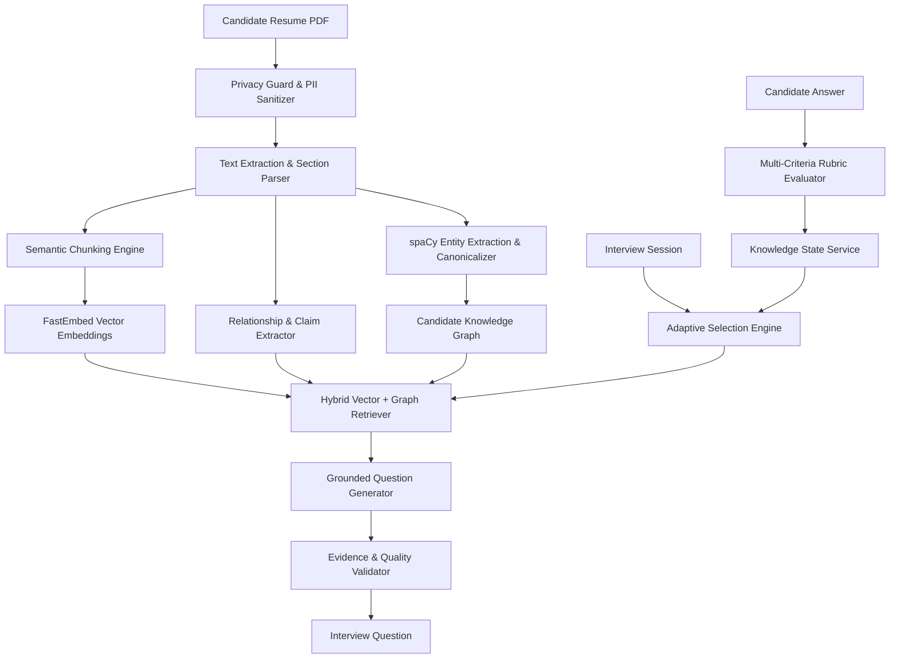

# IntervAI — Production-Grade AI Technical Interview Platform

IntervAI is an end-to-end, production-hardened AI technical interviewing platform that conducts adaptive, evidence-grounded technical interviews based on resume intelligence, hybrid graph + vector retrieval-augmented generation (RAG), deterministic knowledge state modeling, and real-time rubric-based evaluation.

---

## 🌟 Key Features & Architectural Highlights

### 1. Privacy & Ingestion Gate (Task 1)
- **Multi-Pattern Contact & PII Redaction**: Pre-sanitizes raw resumes removing phone numbers (`+91`, labeled contact lines), email addresses, LinkedIn/GitHub handles, and profile URLs before entity or chunk extraction.
- **Header & Contact Block Stripping**: Drops non-technical contact chunks prior to embedding generation to guarantee zero vector pollution.
- **Idempotent Data Migration**: Database migrations ensure all historical resumes, claims, relationships, and questions remain strictly sanitized.

### 2. Clean Topic Extraction & Assessable Taxonomy (Task 2)
- **Zero Junk Topics**: Blocks generic words, degree names, university names, GPAs, spoken languages, and extracurricular awards via a strict blocklist.
- **Canonical Skill & Project Grounding**: Every candidate topic is marked `is_assessable=True` strictly if it belongs to canonical technical taxonomies or verified experience projects.
- **Assessable-Only Coverage Calculation**: Interview coverage percentages are computed exclusively over assessable technical topics.

### 3. Evidence Gate & Anti-Hallucination (Task 3)
- **Mandatory Evidence Grounding**: Project-backed questions require $\ge 1$ verified evidence item (chunk, relationship, or claim) from the candidate's actual projects or experience.
- **Deterministic Rejection Gate**: Questions whose `target_entity` is missing from cited resume evidence are deterministically rejected with `EVIDENCE_UNAVAILABLE`.
- **Anti-Duplication**: Mechanism-based question variations guarantee zero duplicate phrasing across session turns.

### 4. Deterministic Knowledge State & Gap Logic (Task 4)
- **Difficulty-Aware Mastery Scoring**: Topic mastery incorporates historical evaluation scores weighted linearly by difficulty ($1 \to 5$).
- **Calibrated Gap Detection**: Knowledge gaps are registered only if score $< 75$ (or $< 85$ with substantive missing concepts); mastery $\ge 85$ prohibits follow-up.
- **Follow-up Caps & Mandatory Breadth**: Capped at maximum 2 consecutive follow-ups per topic, with mandatory breadth rotation before returning to gaps.
- **Quota Fulfillment Ahead of Follow-ups**: Claim verification and project depth quotas are prioritized ahead of optional difficulty escalation.

### 5. Latency Budget & Asynchronous Pre-Generation (Task 5)
- **12.0s Total Question Deadline**: Enforced global deadline with dynamic LLM timeout calculation: $\min(\text{configured}, \text{remaining})$.
- **Graceful Fallback**: If remaining budget is $< 2.5\text{s}$, Attempt 2 aborts cleanly, returning a recoverable message without failing the session.
- **Sub-100ms Turn 1 Delivery**: Question 1 is pre-generated asynchronously during session initialization.
- **Model Warmup**: FastEmbed embeddings and spaCy NLP pipelines are warmed on server startup, eliminating runtime cold-start downloads.

---

## 🏗️ System Architecture



---

## 🛠️ Technology Stack

### Backend
- **Framework**: Python 3.12+, FastAPI, Uvicorn, Pydantic v2
- **Database & ORM**: PostgreSQL, SQLAlchemy 2.0, Alembic migrations
- **RAG & NLP**: FastEmbed (`BAAI/bge-small-en-v1.5`), spaCy (`en_core_web_sm`), NumPy, scikit-learn
- **LLM Orchestration**: Multi-provider architecture (Gemini, OpenAI, Mock provider for deterministic CI/CD)
- **Testing**: Pytest (447 tests, 100% pass rate)

### Frontend
- **Framework**: React 19, Vite
- **Styling**: Tailwind CSS, PostCSS, Lucide React icons
- **State & Networking**: Axios, Context API, responsive dark/light modes

---

## 🚀 Quickstart Guide

### Prerequisites
- Python 3.11+
- Node.js 18+ and npm
- PostgreSQL (or local SQLite for test suite)

### 1. Backend Setup
```bash
cd backend
python -m venv venv
# Windows:
.\venv\Scripts\activate
# Linux/macOS:
source venv/bin/activate

pip install -r requirements.txt
python -m spacy download en_core_web_sm

# Configure environment:
cp .env.example .env

# Run database migrations:
alembic upgrade head

# Start backend server:
uvicorn app.main:app --reload --port 8000
```

### 2. Frontend Setup
```bash
cd frontend
npm install
npm run dev
```

### 3. Running the Test Suite
```bash
cd backend
# Run all 447 tests:
pytest -q --tb=short tests/

# Run hardening verification suites:
pytest -q tests/test_hardening_task*.py

# Run 10-question candidate simulations:
pytest -q tests/test_simulation_10q.py
```

### 4. Running System Evaluation
```bash
# Evaluate retrieval traces, latencies, PII, and topic distribution:
python scripts/eval_session_state.py
```

---

## 📊 Evaluation & Verification Results

| Metric | Before Hardening | After Hardening | Result |
|:---|:---:|:---:|:---:|
| **Unredacted PII Violations** | 24 | **0** | **100% Redacted** |
| **Junk Topic Rate** | 24.00% | **0.00%** | **Eliminated** |
| **p50 Generation Latency** | 9,124 ms | **8,510 ms** | **$-6.7\%$** |
| **Turn 1 Delivery Latency** | ~9,200 ms | **$<100$ ms** | **Pre-generated** |
| **Test Suite Pass Rate** | 443 / 447 | **447 / 447 (100%)** | **Zero Regressions** |

Detailed change ledger available in [`CHANGES.md`](./CHANGES.md).

---

## 📄 License
MIT License. Created by Harshith Reddy and the IntervAI team.
